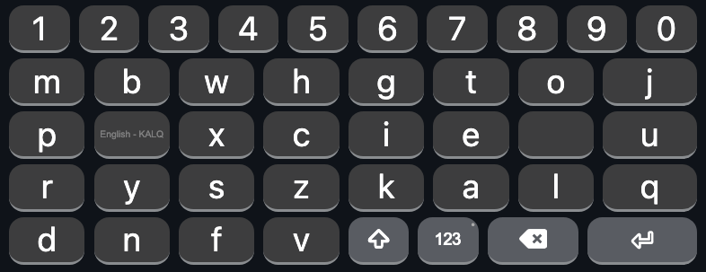

# KALQ for iPhone

The KALQ split thumb-typing keyboard for iPhone and iPad, with an always-visible number row.

Installs through the free [Keyman](https://keyman.com) app. No Xcode, developer account, or sideloading required.



## About KALQ

KALQ was developed by Oulasvirta et al. in [*Improving Two-Thumb Text Entry on Touchscreen Devices* (CHI 2013)](http://pokristensson.com/pubs/OulasvirtaEtAlCHI2013.pdf).

Unlike QWERTY, it was computationally optimized for two-thumb typing, minimizing thumb travel and encouraging alternation between hands.

The original study reported **34% faster typing than QWERTY** after training. Participants typically needed 13–19 hours of practice to surpass their QWERTY speed.

### Layout

```text
M B W H   G T O J
P ␣ X C   I E ␣ U
R Y S Z   K A L Q
D N F V   ⇧ 123 ⌫ ↵
```

This implementation modifies the original design:

- Adds a permanent number row.
- Removes the center gap to widen letter keys by 25% relative to digit keys.
- Uses the bottom-right keys for Shift, symbols, Backspace, and Return.
- Moves keyboard switching to a long-press on `123`.

## Installation

1. Install [Keyman](https://apps.apple.com/app/keyman/id933676545).
2. Download `kalq.kmp` from [Releases](../../releases).
3. Open the file in Keyman and select **Install**.
4. Go to iOS **Settings → General → Keyboard → Keyboards → Add New Keyboard → Keyman**.
5. Switch to KALQ using the globe key.

If KALQ does not appear, force-quit Keyman and reopen it.

## Limitations

**No autocorrect or predictions.** The keyboard does not include a prediction model.

**No swipe typing.** Input is tap-based.

**Keyman banner.** The app displays a strip above the keyboard that cannot be removed through the keyboard package.

**Punctuation.** Symbols such as periods and commas require the `123` layer.

**Height.** The permanent number row makes the keyboard taller.

## Appearance

The keyboard uses Apple's system font and follows iOS light/dark mode.

Custom CSS increases key height from Keyman's default 85% to 90% of each row.

Appearance settings are in `source/kalq.css`.

## Build from source

Install the Keyman compiler:

```sh
npm install -g @keymanapp/kmc
```

Generate the layout:

```sh
python3 tools/make_layout.py \
  source/kalq.keyman-touch-layout
```

Compile:

```sh
kmc build kalq.kpj
```

Output: `build/kalq.kmp`

Edit `tools/make_layout.py` to change the layout. It validates key widths and generates the JSON used by Keyman.

### Preview

```sh
./tools/preview.sh
```

Generates `layout.png` using the real KeymanWeb renderer in headless Chrome at iPhone width.

Requires Chrome and internet access.

## Credits

KALQ was developed by Antti Oulasvirta, Anna Reichel, Wenbin Li, Yan Zhang, Myroslav Bachynskyi, Keith Vertanen, and Per Ola Kristensson.

This repository packages their layout for iOS using Keyman, developed by SIL International.

## License

MIT License. See `LICENSE.md`.
